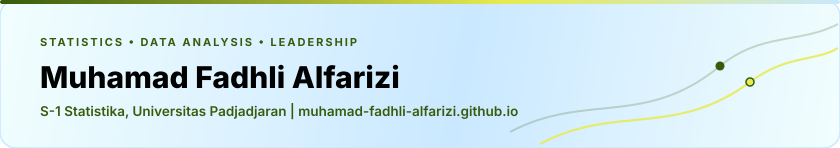



  

  Statistics undergraduate at <strong>Universitas Padjadjaran</strong> focusing on statistical modeling, EDA, and quality control—combining analytical rigor with organizational leadership.

  
  
  
  

  
  
  
  
  

