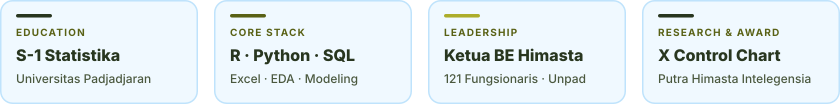



  

  
  
  

 

  

## About

Mahasiswa **S-1 Statistika di Universitas Padjadjaran (Unpad)** yang berfokus pada **pemodelan statistika, *Exploratory Data Analysis* (EDA), dan analisis kuantitatif berbasis data**. Terbiasa mengolah data mentah menjadi temuan yang terstruktur, terukur, dan mudah dipahami untuk mendukung pengambilan keputusan.

## Tech Stack & Analytical Tools

  
  
  
  
  
  
  
  

## Experience & Highlights

| Peran / Pencapaian | Institusi | Kontribusi Utama |
| :--- | :--- | :--- |
| **Asisten Laboratorium** | Universitas Padjadjaran | Membimbing praktikum *Metode Statistika Parametrik* dan *Exploratory Data Analysis (EDA)*. |
| **Community Satisfaction Surveyor** | RS Hasan Sadikin (RSHS) Bandung | Melaksanakan pengumpulan data survei kepuasan masyarakat secara objektif dan terstruktur. |
| **Ketua BE Himasta FMIPA Unpad** | Kabinet Madya Prakarsa | Memimpin 121 fungsionaris dalam perencanaan strategis, administrasi, dan eksekusi program kerja. |
| **Riset Kuantitatif & Penghargaan** | Statistika FMIPA Unpad | Publikasi riset nilai tukar Rupiah menggunakan *X Control Chart* • Penerima penghargaan *Putra Himasta Intelegensia*. |

## GitHub Analytics

  
  

  Terbuka untuk kolaborasi riset data, analisis statistika, dan proyek analitik • <a href="https://muhamad-fadhli-alfarizi.github.io">muhamad-fadhli-alfarizi.github.io</a>

